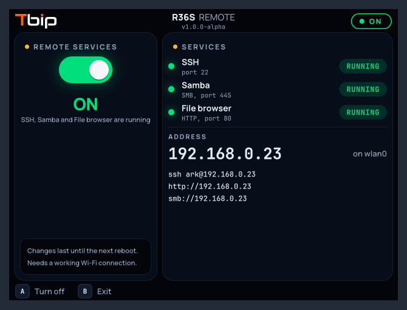
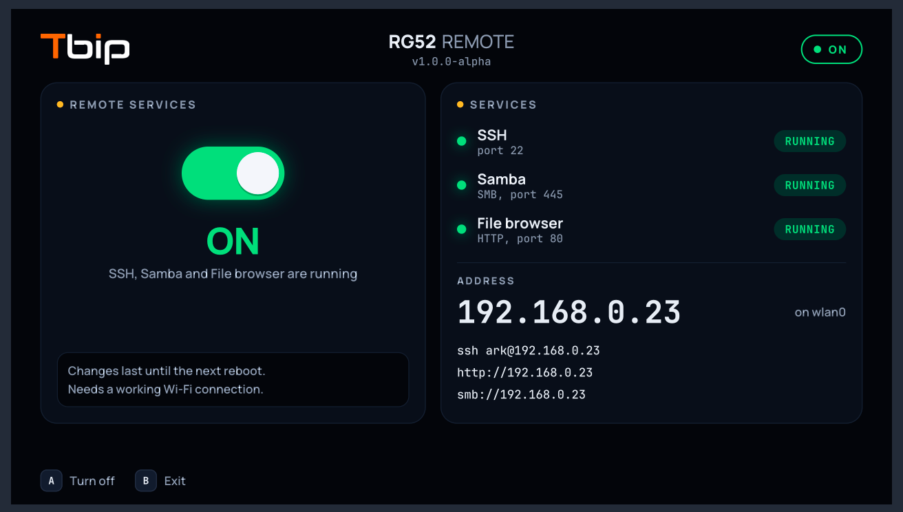

<p align="left">
  <picture>
    <source media="(prefers-color-scheme: dark)" srcset="docs/tbip-light.svg">
    <source media="(prefers-color-scheme: light)" srcset="docs/tbip-dark.svg">
    
  </picture>
</p>

<p align="left"><strong>Turning Bits Into Products</strong></p>

# remote-service

Liga e desliga os **Remote Services** do dArkOS (SSH, Samba e filebrowser) numa tela só,
no mesmo visual dos outros apps do dArkOS. Substitui, no menu Tools, o par
`Enable Remote Services.sh` / `Disable Remote Services.sh`.

| R36S | RG52 Mini |
|---|---|
|  |  |

## Aparelhos

O app funciona em **qualquer aparelho com dArkOS**, inclusive modelos ainda sem perfil. Fora do dArkOS ele mostra **DEVICE INCOMPATIBLE** e não executa nenhum `sudo systemctl`. A tela se adapta a 16:9, 4:3 e 3:2.

O aparelho é identificado por `--device`, `/home/ark/.config/.DEVICE`, hostname e chip, nesta ordem. Os perfis ficam em `src/devices/`, pasta idêntica em led-rgb, remote-services e system-info. Use `--device ID` (`rg52mini`, `rg43`, `r36s`, `rgb10`, `a10mini`, `rk3566`, `generic`) ou `DEVICE_PROFILE=ID` no script para forçar um perfil.

## Como usar

| Botão | Ação |
|---|---|
| **A** (ou Enter / Espaço / toque no interruptor) | Ligar se estiver desligado ou parcial; desligar se estiver ligado |
| **B** (ou Start / Esc) | Sair (bloqueado enquanto uma ação está rodando) |

A tela mostra o interruptor grande (ON / OFF / PARTIAL), o estado de cada serviço
(SSH porta 22, Samba porta 445, File browser porta 80), o IP da rede e os comandos para
conectar (`ssh ark@IP`, `http://IP`, `smb://IP`). Sem Wi-Fi, ligar é recusado com a mesma
orientação do script original.

## O que cada ação faz (igual aos scripts originais)

**Ligar:** `systemctl enable/start NetworkManager-wait-online`, `timedatectl set-ntp 1`,
`start smbd`, `start nmbd`, `start ssh.service` e
`filebrowser -a 0.0.0.0 -p 80 -d /home/ark/.config/filebrowser.db -r /` em segundo plano.

**Desligar:** `pkill filebrowser`, `stop ssh.service`, `stop smbd`, `stop nmbd`,
`timedatectl set-ntp 0` e `disable/stop NetworkManager-wait-online`.

Tudo roda com `sudo -n` (sem pedir senha; o usuário `ark` já tem sudo livre). Os efeitos
duram até o próximo boot, como nos scripts originais (os `enable` dos serviços continuam
comentados). Passos obrigatórios que falham param a ação e mostram o erro; os opcionais
(NTP, wait-online) só viram aviso.

O estado vem de `/proc` (processos `sshd`, `smbd`, `filebrowser`), sem root.

## Instalação

1. Compile no aparelho: `cargo build --release` (precisa de `libsdl2-dev`).
2. Copie `target/release/remote-service` para uma pasta `remote-service/` ao lado do script
   `scripts/Remote Services.sh` no menu Tools (ou `/opt/remote-service/remote-service`).
3. `chmod +x "Remote Services.sh"`. Para trocar o destaque: `ACCENT=teal`.

## Linha de comando

```
remote-service --status       # imprime on / partial / off (código 0 se algum serviço roda)
remote-service --enable       # liga sem abrir a tela
remote-service --disable      # desliga sem abrir a tela
remote-service --dry-run      # simula tudo, não executa nada (para testar no PC)
remote-service --dry-run --no-network
```

## Ícone na barra de cima (Wi-Fi / energia / bateria)

Quem desenha esses ícones é o **EmulationStation**, não os scripts: ele os pinta como
bitmaps 32x16 no `swapBuffers` do `Renderer_GLES10.cpp`. Por isso o ícone exige um patch
pequeno no ES (pasta `es-patch/`):

* o app mantém o arquivo `/tmp/remote-service.on` (existe quando algum serviço está rodando;
  atualizado ao abrir o app, a cada ação e em `--status`). `/tmp` é limpo no boot e os
  serviços também voltam desligados, então os dois nunca ficam fora de sincronia depois
  de um reinício;
* o patch (`es-patch/remote-service-indicator.patch`) adiciona `RemoteIcon.h` (ícone de
  terminal `>_`) e um bloco que o desenha no slot livre `w - 135`, à esquerda do Wi-Fi
  (`w - 100`), da energia (`w - 65`) e da bateria (`w - 32`); sem o arquivo, o slot fica
  em branco, ou seja, nada aparece.

Aplicar: `git apply es-patch/remote-service-indicator.patch` na raiz do código do ES e
recompilar. Se alguém ligar os serviços pelos scripts antigos, o arquivo só é atualizado
na próxima vez que o app (ou `remote-service --status`) rodar.

## Verificado e não verificado

* 27 testes automáticos (estado por `/proc` falso, rota padrão, planos de comandos,
  ligar/desligar/falhas na simulação, arquivo de estado, desenho da tela e clique).
* O patch do ES foi checado com `git apply --check` no código do fork
  `christianhaitian/EmulationStation-fcamod`, **mas não foi compilado**, e esse fork é o
  da linha Odroid Go (go2/DRM). Não confirmei que o ES do dArkOS usa o
  mesmo `Renderer_GLES10.cpp` e as mesmas posições.
* Não testado no aparelho: os comandos reais com `sudo -n`, a tela no KMSDRM e o
  launcher dentro do EmulationStation.

---

Ferramentas open source para consoles portáteis com dArkOS

A **Tbip** (*Turning Bits Into Products*, ou "transformando bits em produtos") desenvolve ferramentas **open source** para o [dArkOS](https://github.com/christianhaitian/dArkOS), sistema usado em consoles portáteis de jogos. Nosso objetivo é substituir telas de terminal e scripts por interfaces gráficas claras, feitas para usar com os botões do próprio aparelho.

Todas as ferramentas são escritas em **Rust** e usam **SDL2**. Elas identificam o aparelho automaticamente, mostram apenas o que ele possui e adaptam o layout à tela. 


## Open source

Nossos projetos são distribuídos sob a **licença MIT**. Você pode usar, estudar, modificar e redistribuir o código, inclusive em outros projetos, desde que mantenha o aviso de copyright e a licença.
